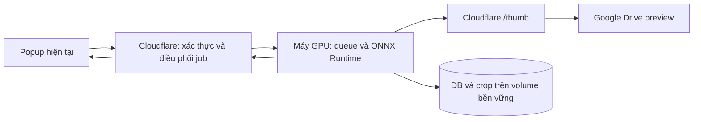

# Phương án máy chủ nhận diện khuôn mặt

Ngày chuẩn bị: 23/10/2026.

## Hiện trạng và phần đã chuẩn bị

- Website dùng Next.js, Supabase và Cloudflare Worker. Pipeline đang hoạt động
  nhận diện trên trình duyệt bằng face-api, vector 128 chiều và cache IndexedDB.
- Đợt sửa này giảm số lượt detect/embedding lặp, dùng preview 1024px, cache theo
  phiên bản ảnh và giữ nguyên giao diện nhận diện.
- `services/face-analysis/` là dịch vụ Python/ONNX chuẩn bị cho máy chủ riêng:
  SCRFD + ArcFace 512 chiều, queue nền, DB bền vững, hủy/tiếp tục và gom nhóm
  cosine. Dịch vụ này chưa được thuê máy chủ, nạp model hay nối vào production.

## Cấu hình đề xuất

| Thành phần | Đề xuất khởi đầu |
| --- | --- |
| GPU | 1 NVIDIA L4 24GB hoặc GPU CUDA tương đương |
| CPU / RAM | Từ 8 vCPU / 16GB RAM; tăng RAM nếu album có rất nhiều mặt |
| Lưu trữ | Volume bền vững 50–100GB cho model, DB, crop và checkpoint |
| Inference | ONNX Runtime CUDA, một job album/GPU, model nạp sẵn |
| Tải và decode | 8 worker, preview 640–1024px qua Cloudflare |
| Batch | Embedding 32–64 mặt; detector theo batch thật mà model hỗ trợ |
| DB ban đầu | SQLite WAL trên volume bền vững, một tiến trình xử lý queue |
| Khi mở rộng | Chuyển queue/DB sang Redis + PostgreSQL trước khi chạy nhiều replica |

GPU là đề xuất để ưu tiên mục tiêu thời gian. CPU vẫn có cấu hình chạy riêng,
nhưng chưa có số đo để khẳng định đạt 700 ảnh trong 1–2 phút.

### Chi phí tham khảo

Bảng giá Runpod ngày tra cứu niêm yết L4 Pod khoảng **0,59 USD/giờ**.
Ví dụ 10 giờ chạy/tháng tương đương **5,90 USD tiền GPU**; chạy liên tục 30 ngày
tương đương **424,80 USD**. Chưa gồm volume, lưu trữ, mạng, khởi động và giấy phép
model; giá thực tế phụ thuộc lựa chọn máy/vùng và báo giá lúc thuê.
Nguồn: [Runpod Pricing](https://www.runpod.io/pricing).

Giai đoạn đầu nên bật máy trong thời gian cần xử lý, giữ DB trên volume bền vững.
Nếu muốn tự tắt/mở theo nhu cầu, cần thêm bộ điều phối luôn hoạt động để giữ queue
và chỉ tắt GPU sau khi job đã hoàn tất; không tắt container giữa một job nền.

## Kiến trúc khi kích hoạt máy chủ riêng

Ảnh gốc không đi qua Vercel. Backend chỉ tải preview từ origin Cloudflare được
cho phép. RAW sử dụng JPEG preview của Drive; nếu không có preview thì báo ảnh
chưa xử lý được, không tự tải RAW gốc về để detect.

## Pipeline

1. Nhận ID ảnh và `modifiedTime`/hash từ nguồn tin cậy. Khóa một phiên bản ảnh để
   các job đồng thời không chạy model lặp.
2. Đọc kết quả DB nếu model và phiên bản ảnh khớp. Ảnh không đổi không chạy lại
   detector hoặc embedding. Khi thiếu phiên bản, hash preview để kiểm tra lại.
3. Nhiều worker tải/decode preview, giới hạn kích thước và bộ nhớ. Detector chạy
   một lượt mỗi ảnh; căn chỉnh mặt rồi gom batch embedding.
4. Lưu vector float32 512 chiều chuẩn hóa L2, box chuẩn hóa, crop, chất lượng,
   phiên bản model và trạng thái ảnh trong một transaction.
5. Gom các mặt rõ bằng average linkage trên cosine từ vector đã lưu; dùng ma
   trận theo khối để giới hạn RAM. Hai mặt khác vị trí trong cùng ảnh không được
   tự động gộp cùng người. Giới hạn ngưỡng và độ chênh so với ứng viên thứ hai.
6. Gộp các cụm có centroid gần và đủ bằng chứng. Mặt chất lượng thấp chỉ được gán
   vào cụm có sẵn, không tạo thêm danh tính. Chọn mặt rõ/chính diện làm đại diện.
7. Hủy tại checkpoint; tiếp tục job dùng lại các ảnh đã hoàn tất trong DB.

## Tương thích với website hiện tại

Giữ các trường `DetectedFaceRecord`, `FaceCluster` và tiến trình đang dùng.
Trước khi bật production cần hoàn tất gateway Cloudflare có xác thực, adapter
job và chuyển đổi engine đồng bộ cho cả album lẫn ảnh mẫu tải lên. Không trộn
vector 128 chiều đang dùng với ArcFace 512 chiều, không áp ngưỡng Euclidean cũ
trực tiếp cho cosine mới. Các thao tác đặt tên/gộp/tách được giữ qua lớp ánh xạ
ID theo ảnh và vị trí mặt, không xóa dữ liệu thủ công để đổi model.

Các endpoint riêng đã chuẩn bị nằm trong README của dịch vụ. Token dịch vụ chỉ
nằm ở gateway/máy chủ, không đưa vào JavaScript công khai của website.

## Điều kiện xác nhận mốc 1–2 phút

700 ảnh/120 giây cần thông lượng toàn pipeline tối thiểu **5,84 ảnh/giây**.
Đây là yêu cầu, chưa phải kết quả đo. Thời gian còn phụ thuộc số mặt mỗi ảnh,
tốc độ preview, trạng thái model nóng/lạnh và số album cùng chạy.

Sau khi có máy và model, cần đo trên album thực tế khoảng 700 ảnh: thời gian tải,
detect, embedding, gom nhóm và tổng thời gian; đo riêng lượt đầu và lượt cập nhật
cache. Chỉ xác nhận SLA sau khi có số đo và đối chiếu nhóm người do chủ album xác
nhận. Các nhóm chưa chắc chắn giữ tách riêng thay vì nới ngưỡng để ép giảm số nhóm.

## Model và bước kích hoạt tiếp theo

InsightFace cho phép dùng mã nguồn theo MIT, nhưng các bộ trọng số pretrained
công khai như buffalo được công bố cho nghiên cứu phi thương mại. Website kinh
doanh cần trọng số được cấp phép phù hợp hoặc model tự sở hữu; dịch vụ không tự
tải bộ buffalo để đưa vào vận hành.
Nguồn: [InsightFace — model licenses](https://github.com/deepinsight/insightface/blob/master/python-package/docs/model_zoo.md).

Để kích hoạt: chọn máy/vùng và ngân sách, cung cấp model hợp lệ, dựng dịch vụ với
volume bền vững, nối gateway/adapter và chạy đánh giá trên album thực tế. Việc
chuẩn bị mã nguồn/phương án hiện tại không tạo máy chủ tính phí.
